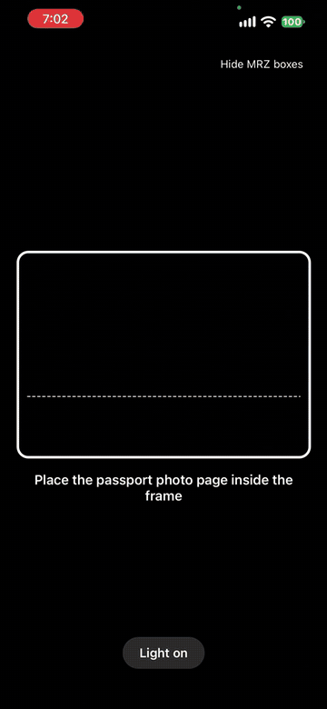

# react-native-vision-camera-mrz

[](https://www.npmjs.com/package/react-native-vision-camera-mrz)
[](https://github.com/AbadurRehman/react-native-vision-camera-mrz/actions/workflows/ci.yml)
[](LICENSE)

Scan the machine-readable zone (MRZ) of passports with [VisionCamera v5](https://visioncamera.margelo.com). Fully on-device: no network calls, no license key, works offline from the first launch.

<p align="center">
  
</p>

- **Fast.** In the demo above, the passport is confirmed 0.4 s after its MRZ comes into view.
- **Drop-in or bring your own camera.** Use the ready-made `<MrzScanner />`, or add MRZ scanning to the VisionCamera screen you already have with `useMrzScanner`.
- **Checked before it's reported.** A scan is reported only when every ICAO 9303 check digit matches and several frames agree.
- **Built for real OCR.** Repairs what phone OCR gets wrong: missing fillers (`<`), lines split into pieces, `O` read as `0`.
- **Native text recognition.** Apple Vision on iOS, ML Kit with a bundled model on Android, built on [Nitro Modules](https://nitro.margelo.com).
- **Parser included.** `parseMrz` validates MRZ text from any source and never throws.

_Community plugin, not affiliated with Margelo or the VisionCamera team._

## Contents

- [Requirements](#requirements)
- [Installation](#installation)
- [Usage](#usage)
- [The result](#the-result)
- [Supported documents](#supported-documents)
- [Privacy](#privacy)
- [Troubleshooting](#troubleshooting)
- [API](#api)

## Requirements

- React Native 0.86 or newer (New Architecture)
- `react-native-vision-camera` 5.2 or newer, with `react-native-vision-camera-worklets` and `react-native-worklets`
- `react-native-nitro-modules` 0.37.2 or newer
- iOS 15.1+, Android 7.0+ (API 24)

Expo works with a development build (`npx expo prebuild`), not Expo Go.

## Installation

```sh
npm install react-native-vision-camera-mrz react-native-vision-camera react-native-vision-camera-worklets react-native-worklets react-native-nitro-modules react-native-nitro-image
cd ios && pod install
```

Add the worklets Babel plugin if you haven't already (`babel.config.js`), then restart Metro with `--reset-cache`:

```js
module.exports = {
  presets: ['module:@react-native/babel-preset'],
  plugins: ['react-native-worklets/plugin'],
};
```

Add the camera permission:

- **iOS:** `NSCameraUsageDescription` in `Info.plist`, e.g. "Scan your passport to fill in your details."
- **Android:** `<uses-permission android:name="android.permission.CAMERA" />` in `AndroidManifest.xml`
- **Expo:** `ios.infoPlist.NSCameraUsageDescription` and `android.permissions: ["android.permission.CAMERA"]` in `app.json`

## Usage

### Drop-in scanner

`<MrzScanner />` shows the camera with a passport-shaped guide, hints and a light button. It asks for camera permission and calls `onResult` once:

```tsx
import { MrzScanner } from 'react-native-vision-camera-mrz';

function ScanPassportScreen() {
  return (
    <MrzScanner
      style={{ flex: 1 }}
      onResult={(result) => {
        const { surname, givenNames, documentNumber, dateOfBirth } =
          result.fields;
        // dateOfBirth.iso → '1974-08-12'
      }}
    />
  );
}
```

Scanning stops after a result. To scan another document, call `reset()` through a ref:

```tsx
import { MrzScanner, type MrzScannerHandle } from 'react-native-vision-camera-mrz';

const scanner = useRef<MrzScannerHandle>(null);

<MrzScanner ref={scanner} onResult={showResult} />;

scanner.current?.reset();
```

| Prop | Type | Default | |
| --- | --- | --- | --- |
| `onResult` | `(result: MrzScanResult) => void` | required | Called once when a valid MRZ is confirmed. Scanning then stops. |
| `onError` | `(error: Error) => void` | `console.error` | Camera or text recognition failed. |
| `onStatusChange` | `(status: MrzScanStatus) => void` | | `'searching'` (no MRZ in view), `'reading'` (MRZ in view, not confirmed yet) or `'done'`. Useful for haptics or timing scans. |
| `isActive` | `boolean` | `true` | Set to `false` to pause the camera, e.g. when the screen is not focused. |
| `labels` | `Partial<MrzScannerLabels>` | English | Texts for `searching`, `reading`, `done`, `turnOnLight` and `turnOffLight`. |
| `showTorchButton` | `boolean` | `true` | Shown only on devices with a light. |
| `showMrzBoxes` | `boolean` | `false` | Draws the MRZ lines it detects. Handy while integrating. |
| `requiredAgreement` | `number` | `3` | How many recent frames must read the same valid MRZ. |
| `agreementWindow` | `number` | `10` | How many recent frames to consider. |
| `fallback` | `ReactNode` | `null` | Shown instead of the camera when permission was denied. |
| `style`, `testID` | | | |

### Your own camera screen

`useMrzScanner` does the same work and returns a frame output for your own `<Camera />`:

```tsx
import { Camera } from 'react-native-vision-camera';
import { useMrzScanner } from 'react-native-vision-camera-mrz';

function MyCameraScreen() {
  const { frameOutput, state, reset } = useMrzScanner({
    onResult: (result) => console.log(result.fields.documentNumber),
  });

  // state.status: 'searching' | 'reading' | 'done'
  return (
    <Camera style={{ flex: 1 }} device="back" isActive outputs={[frameOutput]} />
  );
}
```

It reads the lower part of the frame (`DEFAULT_SCAN_REGION`). If your screen guides the user elsewhere, pass `regionOfInterest`: a normalized (0–1) rectangle of the upright frame. It also takes `onError`, `isActive`, `requiredAgreement` and `agreementWindow`, as above.

### How a scan is confirmed

For each frame, the scanner joins the pieces of each text row, rebuilds both MRZ lines from the fixed passport layout, and keeps the frame only if every check digit matches.

A result is reported once the same second line has been read in 3 of the last 10 frames. The first line (names and issuing state) has no check digits, so each character is decided by a vote across those frames, and the issuing state and nationality must be known country or organization codes.

Already have OCR output from somewhere else, such as a photo? Pass the lines of each image to `new MrzScanSession().process(lines)`. It does the same work without a camera.

### Reading text in a frame processor

For full control, `useMrzTextRecognizer` gives you the text recognizer on its own:

```tsx
import { useFrameOutput } from 'react-native-vision-camera';
import { useMrzTextRecognizer } from 'react-native-vision-camera-mrz';

const recognizer = useMrzTextRecognizer({
  // The frame is cropped to this normalized (0-1) area of the upright frame.
  regionOfInterest: { x: 0, y: 0.55, width: 1, height: 0.3 },
});

const frameOutput = useFrameOutput({
  pixelFormat: 'yuv',
  onFrame(frame) {
    'worklet';
    try {
      const lines = recognizer.recognizeText(frame); // [{ text, boundingBox }]
      // Send `lines` to JS with scheduleOnRN(...) and pass them to parseMrz.
    } finally {
      frame.dispose();
    }
  },
});
```

Lines come back in reading order. Bounding boxes are normalized to the upright frame (origin top-left, not mirrored).

### Parsing MRZ text

`parseMrz` validates and parses MRZ text from any source, such as OCR output or manual entry. It cleans up OCR noise (case, spaces, look-alike characters such as `O` and `0` in date fields) and never throws:

```ts
import { parseMrz } from 'react-native-vision-camera-mrz';

const result = parseMrz([
  'P<UTOERIKSSON<<ANNA<MARIA<<<<<<<<<<<<<<<<<<<',
  'L898902C36UTO7408122F1204159ZE184226B<<<<<10',
]);

if (!result.ok) {
  // Not a supported MRZ: result.error.code, e.g. 'UNSUPPORTED_FORMAT'
} else if (!result.valid) {
  // Read, but something is wrong: result.issues, e.g. 'CHECK_DIGIT_MISMATCH'
} else {
  result.fields.surname; // 'ERIKSSON'
}
```

Two-digit years are resolved against today: a birth date takes the most recent year that isn't in the future, and an expiry date may be up to 20 years ahead. Pass `{ referenceDate }` for reproducible results.

## The result

`onResult` receives the same shape as a valid `parseMrz` result. For the ICAO 9303 example passport:

| `result.fields` | Value |
| --- | --- |
| `documentCode` | `'P'` |
| `issuingState` | `'UTO'` (Germany is `'D'`) |
| `surname` | `'ERIKSSON'` |
| `givenNames` | `'ANNA MARIA'` (empty when the holder has one name) |
| `documentNumber` | `'L898902C3'` |
| `nationality` | `'UTO'` |
| `dateOfBirth` | `{ raw: '740812', year: 1974, month: 8, day: 12, iso: '1974-08-12' }` |
| `sex` | `'female'`, `'male'` or `'unspecified'` |
| `dateOfExpiry` | `{ raw: '120415', year: 2012, month: 4, day: 15, iso: '2012-04-15' }` |
| `optionalData` | `'ZE184226B'` (personal number; empty when unused) |

It also has `lines` (the two corrected MRZ lines) and `checkDigits` (each check digit, printed and computed).

The scanner doesn't reject expired passports: compare `dateOfExpiry.iso` with today's date if that matters to you.

## Supported documents

| Document | MRZ format | Status |
| --- | --- | --- |
| Passports | TD3 (2 × 44) | Supported |
| ID cards, residence permits | TD1 (3 × 30) | Planned |
| Visas | MRV-A / MRV-B | Planned |

Tested on iPhone and Android phones, including a budget Android, with specimen passports that cover the cases scanners often get wrong: the one-letter state code `D<<`, names cut off at 39 characters, hyphenated and multi-word surnames, a leap-day birth date, sex `X`, and an optional personal number. Also tested in low light, with glare, tilted and held further away. A partly covered MRZ never produced a result.

Out of scope: documents without an MRZ, such as US driver's licenses (PDF417 barcode) or India's Aadhaar (QR code).

> Reading the MRZ doesn't prove that a passport is genuine. For identity verification, combine it with checks such as reading the passport's NFC chip.

## Privacy

Everything happens on the device. The library makes no network requests, stores nothing and sends nothing anywhere. On Android, the ML Kit model is bundled with your app, so no model is downloaded on first launch. This makes your Android app a few megabytes larger.

Scan results contain personal data. Don't log them or send them anywhere without the document holder's consent.

## Troubleshooting

**Nothing is detected.** Hold the passport so its two MRZ lines sit in the lower part of the guide. Set `showMrzBoxes` to see what is being read, and turn on the light in a dim room.

**The scanner stays on "Hold steady…".** It is reading an MRZ but the check digits don't match yet, often because of glare or blur. Tilt the passport slightly or move it a little further away.

**Worklets or frame processor errors at startup.** Check that `react-native-worklets/plugin` is in `babel.config.js`, then restart Metro with `--reset-cache`.

**iOS app crashes at launch when built with Xcode 27.** This comes from your app, not this library: apps built with the iOS 27 SDK must use the scene-based life cycle. The React Native 0.88 template already does. For older apps, see [`AppDelegate.swift`](example/ios/VisionCameraMrzExample/AppDelegate.swift) and the `UIApplicationSceneManifest` entry in [`Info.plist`](example/ios/VisionCameraMrzExample/Info.plist) in the example app.

## API

| Export | |
| --- | --- |
| `MrzScanner` | Drop-in scanner component |
| `useMrzScanner(options)` | Frame output, state and `reset` for your own `<Camera />` |
| `DEFAULT_SCAN_REGION` | Area of the frame `useMrzScanner` reads by default |
| `MrzScanSession` | Multi-frame confirmation, without a camera |
| `useMrzTextRecognizer(options)`, `createMrzTextRecognizer(options)` | Native text recognizer for frame processors |
| `parseMrz(input, options?)` | Validates and parses MRZ text |
| `computeCheckDigit(text)` | ICAO 9303 check digit (7-3-1 weighting) |

All types are exported too, such as `MrzScanResult`, `MrzFields`, `MrzScanStatus` and `MrzScannerProps`.

## Example app

The [example app](example/) is a complete scanner screen that shows how long each scan took. To run it from a clone:

```sh
yarn
yarn nitrogen
yarn example ios     # or: yarn example android
```

See [CONTRIBUTING.md](CONTRIBUTING.md#development-workflow) for details.

## Contributing

- [Development workflow](CONTRIBUTING.md#development-workflow)
- [Sending a pull request](CONTRIBUTING.md#sending-a-pull-request)
- [Code of conduct](CODE_OF_CONDUCT.md)

## License

MIT © [Abad](https://github.com/AbadurRehman)
